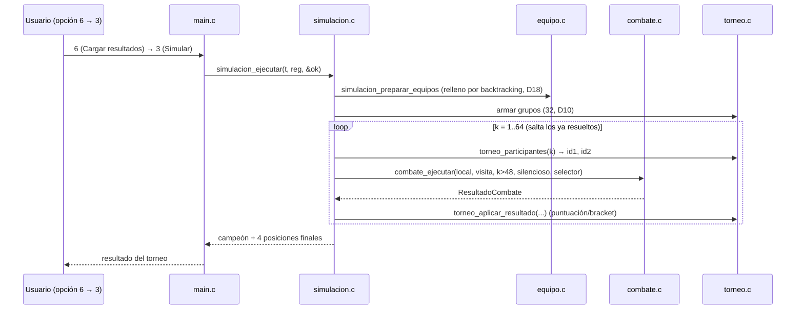

# Diseño: Simulación del torneo + historial de combates + cierres de persistencia

**Change**: `simulacion-torneo`
**Fase**: sdd-design
**Fecha**: 2026-11-16
**Idioma del artefacto**: español neutro y profesional (requisito explícito del proyecto)
**Entradas**: `proposal.md`, auditoría 2026-11-16 (evidencia empírica), `specs/` actuales (menu, torneo, resultados, entrenadores)
**Restricciones**: C99, `gcc -std=c99 -Wall -Wextra` (cero warnings), consola stdin/stdout, sin framework de tests, determinismo total (sin `srand`).

---

## Enfoque técnico

El cambio reutiliza la máquina de estados del torneo y el motor de combate existentes sin duplicar reglas. La **simulación** es un orquestador delgado: recorre los combates 1–64, resuelve los participantes con `torneo_participantes` (RF-RES-03), ejecuta `combate_ejecutar` con un **seleccionador automático** y un **modo silencioso**, y aplica el resultado con `torneo_aplicar_resultado`. Como la fórmula de daño (D1), la derivación de stats (D2) y los desempates (D3/D5) son deterministas, la simulación es **reproducible byte a byte** y verificable con `diff`.

Los otros cuatro cambios son correcciones quirúrgicas: implementar la opción 9 (nueva consulta), conectar una función ya existente (`archivos_guardar_resultados`), y dos micro-fixes de integridad (finalización 63+64 y round-trip de orden de guardado).

Principios transversales que se preservan:

1. **Determinismo total**: la simulación no introduce `srand`; el resultado es función de los datos de entrada.
2. **Nada de lógica de negocio en `main`**: la simulación y el historial viven en `torneo.c`; `main` solo despacha.
3. **Los participantes los resuelve el sistema** (RF-RES-03): la simulación nunca inventa emparejamientos, los lee de la tabla de bracket.
4. **Comportamiento observable estable**: solo cambian los puntos de salida nuevos (opción 9, submenú de simulación) y el fix 63/64; el combate amistoso conserva su traza.

---

## 1. Decisiones de diseño nuevas (D11–D18)

| # | Decisión | Valor adoptado | Rationale |
|---|----------|----------------|-----------|
| **D11** | Selección automática del Pokémon activo en simulación | **Primer Pokémon disponible** (menor posición de la lista) | Determinista y sin consola; `combate_ejecutar` ya recibe un callback `CombateSeleccionar`, así que la simulación provee su propio selector que devuelve `1` (primero con `hp_actual > 0`). No se reordena ni se reimplementa la selección |
| **D12** | Modo silencioso en combate | **Parámetro `bool silencioso`** en `combate_ejecutar` (traza de turnos/dados suprimida; solo se conserva el resultado final) | 64 combates × hasta 20 turnos de traza inundarían la salida. El combate amistoso conserva `silencioso = false`. El cambio es aditivo y no altera los goldens de combate amistoso |
| **D13** | Punto de entrada de la simulación | **Submenú de la opción 6 "Cargar resultados"**: `3. Simular torneo automáticamente` | El menú de 12 opciones es un requisito (RF-MEN-01) y lo verifican goldens; añadir un submenú evita re-numerar las opciones y mantiene la simulación junto a la carga de resultados |
| **D14** | Finalización del torneo | `TORNEO_FINALIZADO` solo cuando **63 y 64 tienen resultado**; aplicar 64 antes de 63 deja el torneo en `TORNEO_ELIMINATORIAS` hasta resolver 63 | Corrige el bug 63/64 sin imponer un orden arbitrario: 63 y 64 son combates independientes (P61-P62 y G61-G62). El campeón (G64) ya es visible en cuanto 64 se resuelve; las 4 posiciones finales requieren ambos |
| **D15** | Round-trip estable del guardado de entrenadores | `archivos_guardar_entrenadores` escribe los ejemplares en **orden inverso** al de la lista enlazada (o el agregado pasa a insertar al final) | El agregado inserta al frente y el guardado recorre de cabeza a cola ⇒ inversión en cada guardado. Escribir en orden inverso restaura el orden original con cambio mínimo y sin tocar el TDA ni el orden de visualización que verifican los goldens 012–015 |
| **D16** | Persistencia de resultados | Bandera `resultados_sucios` en `main`; al salir (opción 12), si hubo resultados aplicados en la sesión, se llama `archivos_guardar_resultados` | `archivos_guardar_resultados` ya existe (F7) y escribe solo los combates resueltos. La bandera evita reescribir el archivo si no hubo cambios (mismo patrón que `entrenadores_sucios`) |
| **D17** | Tests de combate autónomos (blindado) | Reescribir los goldens 012–015 con la convención `_sin_entrenadores`: cada test registra sus propios entrenadores y equipos por el menú (opciones 2/3) antes de combatir | Elimina la dependencia de los tests de combate respecto de `data/entrenadores.txt`; cualquier edición futura de ese archivo deja de romper la batería. Reutiliza el patrón ya establecido por los casos 005–011. Se conserva el equipo de Misty sin regenerar goldens |
| **D18** | Relleno automático de equipos antes de simular (niveles medios + ventana rotativa) | `simulacion_preparar_equipos` genera por `equipo_formar_backtracking` un equipo para cada entrenador cuyo equipo esté vacío o sea inválido; los equipos existentes no se tocan | Niveles **medios** (nuevo campo `nivel_objetivo` en `RestriccionesEquipo`, ej. 30) en vez de nivel 1, y **ventana de especies rotativa determinista** (24 especies, paso 4 por posición) para variedad entre entrenadores. Determinista (sin `srand`) y siempre soluble (`permitir_repetidas=false`, `min_tipos=2`) |
| **D19** | Guía de estilo de pantalla (UI/UX) | Toda consulta usa: título con regla `═` centrado, tablas con cabecera + regla `─`, nombres como `Nombre (id N)`, estados en palabras (`Victoria`/`Empate`/`Pendiente`) y **padding por caracteres visibles UTF-8** (nuevo módulo `pantalla.c/.h`) | Mejora la experiencia de uso sin tocar los archivos de datos (D8). El padding por bytes desalinea las tildes (`Pokémon` = 8 bytes, 7 columnas); `pantalla_ancho` cuenta bytes iniciales UTF-8. Los goldens afectados se regeneran en L7 |

---

## 2. Arquitectura de los cambios

### 2.1 Seleccionador automático y modo silencioso (L1)

```c
/* simulacion.c — selector para la simulación (D11): el primer disponible */
static int seleccionar_primero_disponible(const Entrenador *ent, const char *rol)
{
    (void)rol;
    const Ejemplar *ej;
    int i = 0;
    for (ej = ent->equipo; ej != NULL; ej = ej->siguiente) {
        if (ej->hp_actual > 0) { i++; if (i == 1) return 1; }
    }
    return -1;   /* sin disponibles: no debería ocurrir en simulación */
}
```

`combate_ejecutar` gana un parámetro `bool silencioso` (D12). Con `silencioso = true` se suprimen las impresiones de traza (`=== Combate ===`, `Turno N`, `¡... debilitado!`, desempate) y solo se conserva el `ResultadoCombate` final. La función `combate_atacar` recibe el flag. El combate amistoso sigue llamando con `silencioso = false`, sin cambios en su salida. El selector se define en `simulacion.c` (no en L1: se usa recién en L2 para no disparar `-Wunused-function`).

### 2.2 Simulación del torneo (L2) — módulo nuevo `simulacion.c`

```c
/* simulacion.h — nueva interfaz pública (módulo nuevo) */
void simulacion_ejecutar(Torneo *t, RegistroEntrenadores *reg, bool *exito);
```

`simulacion.c` depende de `torneo.c` (máquina de estados), `combate.c` (motor), `entrenador.c` (búsqueda por id) y `equipo.c` (validación + backtracking). `torneo.c` queda como máquina de estados pura, sin acoplarse al motor de combate.

Algoritmo:

1. **Relleno de equipos (D18)**: `simulacion_preparar_equipos(pd, reg)` recorre los 32 entrenadores; para cada uno con `equipo_validar(...) == false`, arma una ventana de especies **rotativa determinista** (24 especies consecutivas desde `pos * 4`, con envoltura módulo 150) y llama `equipo_formar_backtracking` con restricciones por defecto: `cantidad=6`, `min_tipos=2`, `permitir_repetidas=false`, `nivel_objetivo=30` (niveles medios, no nivel 1) y `nivel_total_max=6*30`. Asigna el resultado con `equipo_asignar`. Los equipos válidos existentes se conservan. Determinista (sin `srand`).
   - **Nuevo campo** `nivel_objetivo` en `RestriccionesEquipo` (equipo.h): con valor `0` conserva el comportamiento actual de la formación automática (nivel 1); con valor `>0`, `bt_rec` asigna ese nivel a cada ejemplar (acotado al presupuesto), produciendo equipos de nivel uniforme medio.
2. Arma los grupos (reutiliza `armar_torneo_si_falta`); exige 32 entrenadores (D10).
3. Para `k = 1..64`: si el combate ya tiene resultado (`estado != RES_PENDIENTE`) lo **salta** (respeta parciales); si no, resuelve `id1,id2` con `torneo_participantes`, obtiene `Entrenador*` de ambos, ejecuta `combate_ejecutar(local, visita, k > COMBATES_GRUPO, /*silencioso=*/true, seleccionar_primero_disponible, &res, &ok)`, y aplica el resultado con `torneo_aplicar_resultado` (V1/V2/empate + KOs).
4. Al completar 48/48, la máquina transiciona a `TORNEO_ELIMINATORIAS` (ya lo hace `torneo_aplicar_resultado`); los participantes 49–64 salen de `ORIGEN_PARTICIPANTE`.
5. Al resolver 63 y 64, muestra las 4 posiciones finales (reutiliza `mostrar_posiciones`).

El selector automático es un helper `static int seleccionar_primero_disponible(...)` (D11) que devuelve la posición 1 entre los disponibles.

Invariante: la simulación **no** reimplementa la puntuación, la clasificación ni el bracket; todo pasa por `torneo_aplicar_resultado`, la única puerta de mutación del estado del torneo. El relleno de equipos reutiliza el backtracking existente (no es un generador ad-hoc).

### 2.3 Opción 9 — historial de combates (L3)

```c
/* torneo.h — nueva función pública */
void torneo_mostrar_historial(const Torneo *t, const RegistroEntrenadores *reg);
```

Lista los combates **1–64** con su estado: para cada combate imprime `NUM;GRUPO/RONDA;ID1;NOMBRE1;ID2;NOMBRE2;RESULTADO;GANADOR;KOS`. Los pendientes muestran resultado vacío y la palabra `PENDIENTE`. Reutiliza `entrenador_por_id`/`nombre_entrenador` (lectura, sin mutación). En `main.c` se añade el `case 9:` que llama a esta función (tras `armar_torneo_si_falta`, informando el rechazo si ≠32 sin terminar el programa, RF-TEC-03).

### 2.4 Persistencia de resultados (L4, D16)

- `main.c`: bandera `static bool resultados_sucios = false;` puesta a `true` en `cargar_resultados` (teclado o archivo) y en `simulacion_ejecutar` cuando se aplicó al menos un resultado.
- `guardar_al_salir` (ya existente) se amplía: si `resultados_sucios`, llama `archivos_guardar_resultados(&torneo, RUTA_RESULTADOS, &exito)` y avisa (mismo patrón que entrenadores).
- `archivos_guardar_resultados` ya escribe solo combates resueltos en formato §5.3; no cambia su firma.

### 2.5 Fix 63/64 (L5, D14)

En `torneo_aplicar_resultado` (y su espejo de validación en `resultados_validar`):

- Antes de transicionar a `TORNEO_FINALIZADO` al aplicar el 64, comprobar que `t->combates[62]` (combate 63) tiene `estado != RES_PENDIENTE`.
- Si 63 sigue pendiente, aplicar 64 pero **mantener** `TORNEO_ELIMINATORIAS` (no finalizar). Al aplicar 63 después, si 64 ya está resuelto, transicionar a `TORNEO_FINALIZADO`.
- `mostrar_posiciones` pasa a tolerar 63 pendiente mostrando `?` para tercero/cuarto (o `PENDIENTE`) sin dejar ids basura.
- Actualizar `probe_torneo_completo.c`: aplicar 63 antes de 64 (o aplicar ambos y verificar que la finalización ocurre con ambos resueltos).

### 2.6 Round-trip estable del guardado (L5, D15)

`archivos_guardar_entrenadores` recorre la lista enlazada **de cola a cabeza** antes de escribir. Como el agregado inserta al frente, la lista en memoria está invertida respecto al archivo; escribir en orden inverso restaura el orden original. Implementación con un arreglo local de punteros (máx `MAX_EQUIPO` = 6):

```c
const Ejemplar *orden[MAX_EQUIPO];
int n = 0, i;
for (ej = ent->equipo; ej != NULL; ej = ej->siguiente) orden[n++] = ej;
for (i = n - 1; i >= 0; i--)   /* escribe en orden inverso → round-trip estable */
    fprintf(archivo, ";%d;%d;%s;%d", orden[i]->id, orden[i]->numero_especie,
            orden[i]->nombre, orden[i]->nivel);
```

Resultado: cargar → guardar → recargar produce el mismo orden de ejemplares. No se toca `equipo_agregar_ejemplar` (el TDA y el orden de visualización que verifican los goldens 012–015 quedan intactos).

### 2.7 Tests de combate autónomos (L6, D17)

Los casos 012–015 se reescriben con la convención `_sin_entrenadores` (ya usada por 005–011): el sandbox arranca sin `data/entrenadores.txt`, y el `.in` registra por el menú los entrenadores y sus equipos (opciones 2 y 3) antes de entrar al combate amistoso (opción 8 → 1). El `.esperado` refleja únicamente ese flujo autónomo.

- **012 (victoria)**: registra dos entrenadores con equipos que producen una victoria determinista; verifica el ciclo de KO y la victoria por agotamiento.
- **013 (empate)**: equipos que llegan a 20 turnos sin KO mutuo (empate por D4).
- **014 (eliminatoria)**: mismo escenario en modo eliminatoria; verifica el anti-empate D5.
- **015 (efectividad)**: dos ejemplares cuyo tipo produce "sin efecto" (multiplicador ×0); verifica la traza E2E.

Con esto, `data/entrenadores.txt` deja de ser entrada de la batería de combate: ninguna edición de ese archivo rompe los tests (el resto de la batería solo usa el conteo de 32 y los nombres/ids). Se conserva el equipo de Misty sin regenerar goldens.

---

## 3. Trazabilidad de requisitos del cambio

| Código nuevo | Requisito | Implementación |
|--------------|-----------|----------------|
| RF-SIM-01 | Simular los 64 combates desde los equipos sin intervención | `simulacion_ejecutar` (simulacion.c) + selector D11 |
| RF-SIM-02 | Simulación determinista y reproducible | D1/D2/D3/D5 existentes; sin `srand` |
| RF-SIM-03 | La simulación respeta la máquina de estados y el bracket | reutiliza `torneo_aplicar_resultado` |
| RF-SIM-04 | Relleno automático de equipos faltantes por backtracking (solo cargar entrenadores) | `simulacion_preparar_equipos` + `equipo_formar_backtracking` (D18) |
| RF-MEN-01 (mod) | Opción 9 implementada | `torneo_mostrar_historial` + `case 9` |
| RF-RES-05 | Persistencia de resultados al salir | `resultados_sucios` + `archivos_guardar_resultados` |
| RF-ELM-05 (mod) | Finalización exige 63+64 | fix D14 |
| RF-ENT-03 (mod) | Round-trip estable del archivo | fix D15 |
| RF-PRB-01 (mod) | Tests de combate autónomos, sin dependencia de `data/entrenadores.txt` | D17, reescritura 012–015 |

---

## 4. Diagrama de flujo de la simulación


